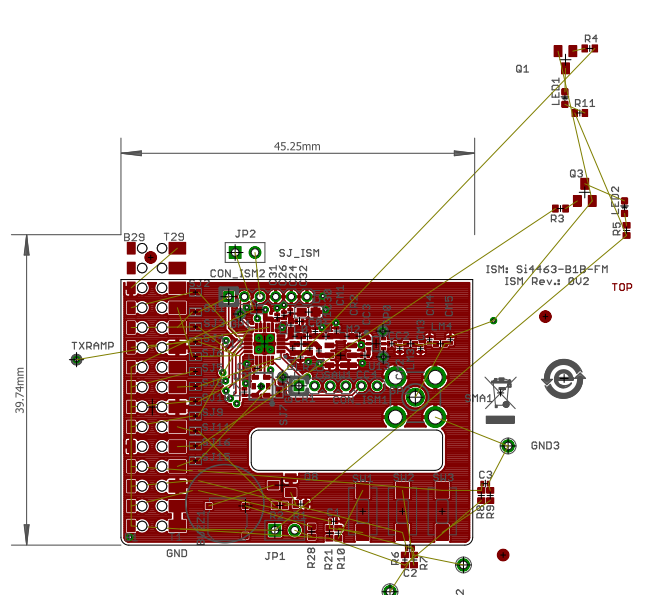

# RPi ISM — open sub-GHz radio HATs for Raspberry Pi



**RPi ISM** is a family of fully open radio add-on boards for the Raspberry Pi.
Hardware, firmware and software are all open source. The goal: turn any
Raspberry Pi into a capable, well-engineered sub-GHz ISM gateway, sensor hub
and RF lab tool, without proprietary hubs or closed binary stacks.

The first member of the family, **RPi ISM v1**, is built around the Silicon Labs
**Si4463** transceiver for the **863–870 MHz (SRD 868)** band. More families
with newer radio chips are planned (see [Product family](#product-family)).

> **Status:** early development. The v1 schematic (rev 0V3) is near-final;
> the PCB layout is being completed and migrated from Eagle to KiCad.
> The software stack is being designed. Not ready for production use yet.

---

## What is it good for?

RPi ISM v1 is an **(G)FSK / OOK** radio. It does *not* speak Zigbee, Thread or
other 2.4 GHz 802.15.4 protocols. It targets the things a cheap 2.4 GHz
dongle cannot do:

| Use case | Who | Notes |
|---|---|---|
| **Wireless M-Bus / OMS meter reading** (EN 13757-4, S1/T1/C1 modes) | Utilities, building management, home users | Water, heat, gas meters and heat-cost allocators. Planned as a [wmbusmeters](https://github.com/wmbusmeters/wmbusmeters) backend, with transmit capability. |
| **868 MHz home automation** | Home Assistant / FHEM / openHAB users | KNX-RF, eQ-3 MAX!, Homematic (classic) and other 868 MHz FSK systems. |
| **Long-range telemetry** | Industrial, agriculture, off-grid | Up to +20 dBm; the 869.40–869.65 MHz sub-band allows 500 mW ERP at 10 % duty cycle. Reaches outbuildings and basements where 2.4 GHz meshes struggle. |
| **RF pre-compliance and lab tool** | Hardware developers, test labs | CW and PN9 test signals, RSSI sweep, band occupancy and duty-cycle monitoring, LBT testing for ETSI EN 300 220. |
| **6LoWPAN / IPv6 over sub-GHz** | Researchers, makers | Through a planned Linux `mac802154` driver (802.15.4g SUN-FSK PHY). |

---

## Hardware — RPi ISM v1 (rev 0V3)

| Item | Part | Notes |
|---|---|---|
| Transceiver | Silicon Labs **Si4463-B1B-FMR** | 119–1050 MHz, (G)FSK/4(G)FSK/OOK, up to +20 dBm. [Datasheet](https://www.silabs.com/documents/public/data-sheets/Si4464-63-61-60.pdf). Moving to **Si4463-C2A** in the next revision. |
| RF filter | TDK/EPCOS **B39871B3725U410** SAW | 869 MHz. This filter fixes the board to the 868 MHz SRD band. [Datasheet](http://www.mouser.com/ds/2/400/B3725-525464.pdf) |
| RF switch | CEL **UPG2214TB-A** | TX/RX switching. [Datasheet](http://www.cel.com/pdf/datasheets/upg2214tb.pdf) |
| Reference | Kyocera **KT2520F26000ACW18TAN** TCXO | 26 MHz. [Datasheet](http://www.mouser.com/ds/2/40/kt2520_gps_e_2012-838160.pdf) |
| Host interface | SPI + GPIO IRQ | 2×15 receptacle (Samtec CLH-115), mates with pins 1–30 of the Raspberry Pi GPIO header (SPI0 included) |
| Extras | Buzzer (BC817 driver), status LEDs | |
| PCB | 2 layers, 45.1 × 34.1 mm | |

Design files are in [`CAD/`](CAD/) (Eagle 6.4, with PDF exports of the
schematic and both copper layers).

### Known issues in rev 0V3

- PCB layout is not finished yet (unrouted nets, components outside the board outline).
- Missing flyback diode across the inductive buzzer load on the BC817 collector.
- TCXO `VC` pin floats through SJ7 (fine for the non-VC KT2520 variant only).
- The matching network is tuned for 868 MHz; other bands need new values.
- The SAW filter and the RF switch are not stocked at LCSC (relevant for JLCPCB assembly).

### Planned for the next revision

- KiCad migration, finished layout, JLCPCB-ready fabrication and assembly files (Gerber, BOM, CPL).
- **Band variants** via BOM options: 433 MHz, 868 MHz, 915 MHz (SAW filter and matching network change).
- Si4463-C2A silicon, the fixes listed above.

---

## Software stack (planned)

```
┌──────────────────────────────────────────────────────────────┐
│ Applications: Home Assistant · MQTT · wmbusmeters · FHEM      │
├───────────────┬──────────────────┬───────────────────────────┤
│ wM-Bus backend│ si446x-cli tools │ Linux mac802154 driver     │
│ (S/T/C modes) │ CW·PN9·RSSI scan │ → 6LoWPAN / IPv6 (wpan)    │
├───────────────┴──────────────────┴───────────────────────────┤
│ libsi446x — portable C driver (clean-room, permissive license)│
├──────────────────────────────────────────────────────────────┤
│ Linux backend: spidev + libgpiod v2  │ HAL for Zephyr / bare  │
└──────────────────────────────────────────────────────────────┘
```

1. **libsi446x** — a clean-room driver written from Silicon Labs' public API
   documentation (AN625). Portable HAL; the first backend is Linux userspace
   (`spidev` + `libgpiod`).
2. **si446x-cli** — test and bring-up tool: CW / PN9 transmit, RSSI sweep,
   packet TX/RX, band occupancy and duty-cycle logging.
3. **Wireless M-Bus** — S1/T1/C1 reception and transmission, with 3-of-6 and
   Manchester decoding in software, integrated as a wmbusmeters backend.
4. **Linux `mac802154` driver** — native 802.15.4g SUN-FSK support for
   `wpan-tools` and 6LoWPAN, aimed at upstream inclusion.
5. **Stretch goals** — DASH7 (reusing the Si4460 PHY driver of the
   Apache-2.0 [Sub-IoT / OSS-7](https://github.com/CoSys-Lab/dash7-ap-open-source-stack)
   stack); a Wi-SUN radio co-processor compatible with Silicon Labs'
   [wisun-br-linux](https://github.com/SiliconLabs/wisun-br-linux) border router.

**Timing note:** at 100 kbps (wM-Bus C1) the 64-byte FIFO (129 bytes when
merged) fills in about 5–10 ms, which a userspace IRQ handler can serve.
Long T1 telegrams and 6LoWPAN at higher rates are better served by the
kernel driver or a PREEMPT_RT kernel.

---

## Product family

RPi ISM v1 is the first board of a family. The shared parts — the
Raspberry Pi mechanical and electrical interface, the Linux integration,
the test tools and the open, clean-room software policy — carry over to
every member. Each new board adds a radio.

| Family | Radio | Bands / protocols | Status |
|---|---|---|---|
| **RPi ISM v1** | Si4463 | Sub-GHz (G)FSK/OOK: wM-Bus, KNX-RF, proprietary FSK, 802.15.4g | In development |
| Next generations | Newer sub-GHz and multi-protocol radios | Candidates: LoRa + FSK, Wi-SUN-class sub-GHz, dual-radio boards adding 2.4 GHz (Zigbee / Thread RCP) next to sub-GHz | Planned |

Chip selection for the next families is open. Suggestions and use cases are
welcome in the issues.

---

## Licensing and clean-room policy

- Everything in this repository is currently licensed under the
  **GNU GPL v3** (see [`LICENSE`](LICENSE)).
- **No code under the Silicon Labs Master Software License Agreement (MSLA)
  is included.** The MSLA is the default license of the Gecko SDK and is
  not an open source license.
- Silicon Labs files that are explicitly marked **Zlib** in their header may
  be reused, with the license notice kept and modifications clearly marked.
- Radio configurations are written from the public datasheet and API
  documentation. Binary ROM patches are not redistributed.
- Third-party code with copyleft licenses (for example RadioHead, GPL) is
  only used where license compatibility is confirmed.

---

## Repository layout

```
CAD/         Eagle design files (schematic, board) and PDF exports — rev 0V3
datasheet/   Reference material for components and Raspberry Pi interfacing
top.png      Layout preview
```

KiCad sources, firmware and software directories will be added as the work
progresses.

---

## Contributing

Issues and pull requests are welcome: hardware review, protocol support,
band variants and real-world test results are all valuable. For larger
changes, open an issue first to discuss the approach.

Developed by **RF Sparkling Kft.** (Budapest / Veszprém, Hungary).
